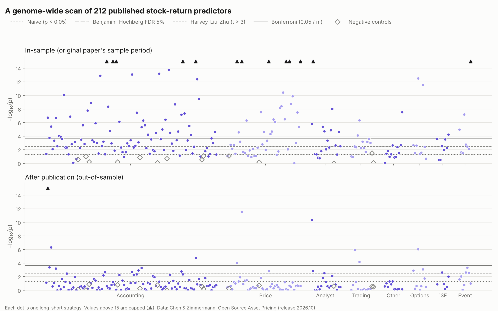
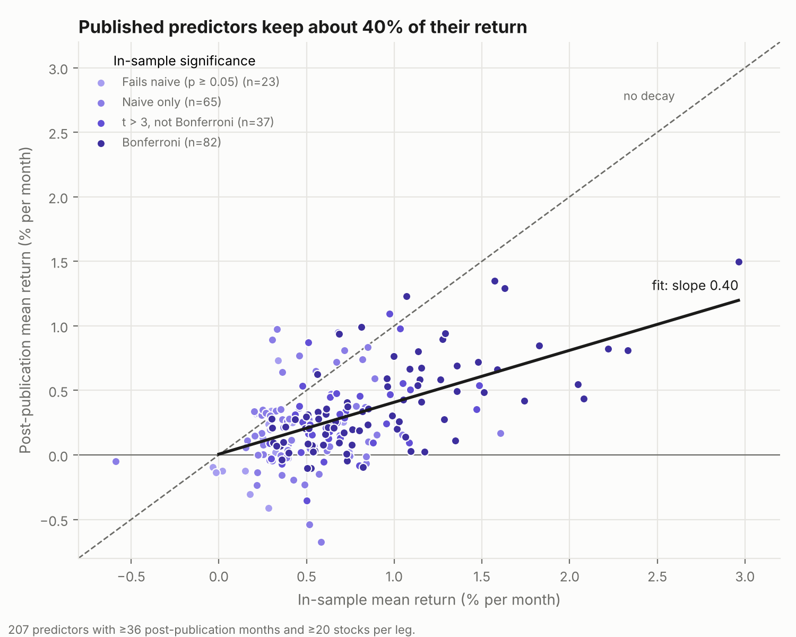
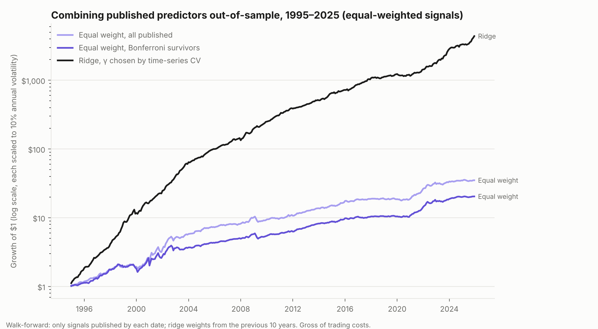
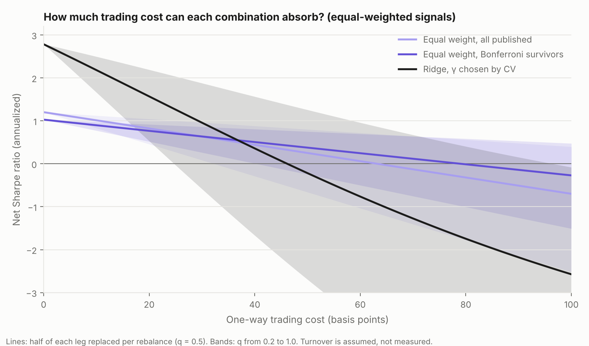

# A Genome-Wide Search of the Factor Zoo

*Idea No. 1 in my ongoing attempt to put my biology degree to use.*

> Acknowledgements: I did use Claude Code to complete this but all code was human reviewed; please see the Reviews and Changes section to see adjustments I requested. Additionally, this README was entirely human written, which is why it's so long. To make up for that I have a static dashboard as a pdf here on GitHub (warning the figures don't render well and it's better on the website) and a normal dashboard on [my website](https://demisdomain.com). I advise looking at those for general information and reading this if you'd like to hear about my thought process.

## Introduction

I started and ended my undergraduate career as a biology major. My decision to double major in Applied Mathematics and Statistics came *after* I took so many classes it made no sense not to. So even though I'm officially an applied mathematics grad student, I tend to approach problems as a biologist. Naturally, my first idea to apply my education was theoretical DNA Computing (if you're curious, this is great in theory but horrible in practice for finance and I'll gladly rant about it over coffee). My second idea was a lot easier: investigate the stock market.

The connection is less of a stretch than it sounds. In genomics, researchers can test enormous numbers (up to tens of millions) of genetic variants for associations with a trait. Test enough things, and some will look convincing purely by chance. Finance has its own version of this problem: researchers have published hundreds of characteristics that supposedly predict stock returns. Collectively, they're called the *factor zoo*. The resemblance was too tempting to ignore.

Genome-wide association studies (GWAS) have a toolkit for dealing with the problem, including multiple-testing corrections and the wonderfully named Manhattan plot. I wanted to know what would happen if I borrowed that toolkit and pointed it at 212 published stock-return predictors.

More specifically, I wanted to ask:

1. How many survive genome-wide-style multiple-testing control in their original samples?
2. Does passing a stricter threshold predict whether a signal keeps working *after it is published*?
3. Is the post-publication decline really about publication, or just about later years?
4. Which signals survive publication, and what do they have in common?
5. If you combined published signals out-of-sample, which combination rule works best?

Publication dates give us a useful dividing line, as the original researchers could not have fitted their models to returns that happened after their papers appeared. That makes post-publication performance an interesting test, although not a perfect causal experiment (market conditions may have changed independently of publication, or other investors may have discovered and traded on the same patterns before the papers appeared).



## Results

- **In-sample:** 187 of 212 predictors pass p < 0.05, 123 pass the Harvey–Liu–Zhu hurdle of t > 3, and 82 pass Bonferroni (p < 0.05 / 212).
- **Benjamini–Hochberg:** 182 of 212 pass at 5% FDR. When most tested signals carry some real effect, FDR control is (very) lenient; Bonferroni is the filter that actually separated signals.
- **After publication, predictors keep about 41% of their in-sample return** (regression slope 0.40), and only 26% remain significant at p < 0.05. This is close to McLean & Pontiff's (2016) headline estimate that long-short returns are 58% lower after publication (and 26% lower after the original sample ends but before publication).
- **About half of that decline is calendar time, not publication.** Comparing published and unpublished signals in the same months, the post-publication drop shrinks from 0.39 to 0.21 percentage points per month (58% &rarr; 31% of the in-sample mean), still significant (t = −2.6). The same 0.21 drop already appears after the sample ends but before publication, which points to overfitting in the original samples more than to arbitrage by readers. (McLean & Pontiff might disagree, as they attribute part of the decline to publication itself.)
- **Stricter screens pick stronger signals, not necessarily more durable ones:** Every tier loses roughly 60% of its return. But Bonferroni survivors start larger, so they end larger, and they are about twice as likely to stay significant after publication (39%, versus 18–22% for signals that pass only weaker thresholds and 4% for those that fail).
- **Only 9 predictors pass Bonferroni after publication, and most are about how prices absorb news:** four track earnings news (announcement return, surprise, surprise streak, analyst revisions) and two track informed traders (option volatility smile, short interest).
- **In-sample leaders mostly don't stay leaders:** The rank correlation between in-sample and post-publication t-stats is 0.38. Of the in-sample top 12, only three stick (short-term reversal, earnings announcement return, earnings streak); several recent accounting and price signals collapse.
- **Negative controls:** of 14 signals the original papers found *not* predictive, 1 passes p < 0.05 in-sample (about the 5% expected by chance) and none pass t > 3.
- **Out-of-sample, combining many signals beats picking a few, but only in small stocks:** Walk-forward (only signals published by each date), an equal-weight portfolio of all published predictors earns a Sharpe ratio of 1.20 over 1995–2025, versus 1.02 for Bonferroni survivors only. A ridge-regularized mean-variance portfolio, with its regularization chosen each year by time-series cross-validation on past data, reaches 2.73 before trading costs (2.78 before the review; see Reviews and Changes).
- **Trading costs:** Ridge looks best gross but earns its edge from low volatility, not high returns, so it can absorb the least cost. With medium turnover assumptions it breaks even at about 45 basis points one-way, versus 61 for the simple equal-weight portfolio, and falls behind it above roughly 37 basis points.
- **In big stocks, most of the zoo disappears:** With value-weighted portfolios, only 77 of 179 predictors pass p < 0.05 in-sample (versus 187 of 212 equal-weighted) and 27 pass Bonferroni; just 2 survive Bonferroni after publication (earnings announcement return and the option volatility smile). Combination Sharpe ratios fall to 0.6–1.1, and now screening helps, as Bonferroni survivors (0.76) beat the equal-weight portfolio of everything (0.63).

| In-sample tier | n | In-sample (%/mo) | Post-publication (%/mo) | Retention | Still significant |
|---|---:|---:|---:|---:|---:|
| Bonferroni | 82 | 0.94 | 0.39 | 41% | 39% |
| t > 3, not Bonferroni | 38 | 0.71 | 0.29 | 41% | 18% |
| Naive only (p < 0.05) | 64 | 0.47 | 0.20 | 43% | 22% |
| Fails naive | 23 | 0.32 | 0.10 | 31% | 4% |
| **All** | **207** | **0.68** | **0.28** | **41%** | **26%** |



Interactive versions (hover for the signal, paper and year): `results/manhattan.html`, `results/survival.html`.

## Did publication actually cause the decline?

Matching McLean & Pontiff's 58% post-publication decline (about 42% of the return retained) shows the pipeline thankfully computes the right thing, but it doesn't show publication caused the decline: post-publication periods are also simply later years, and anomalies in general may have weakened over time (more quant capital, cheaper trading, pandemics, wars, etc.).

The fix is a panel regression with month fixed effects, which compares published and not-yet-published signals in the same calendar months:

$$
r_{i,t} = a_i + m_t + \beta_1\,\text{PostSample}_{i,t} + \beta_2\,\text{PostPub}_{i,t} + \varepsilon_{i,t}
$$

where $a_i$ is a signal fixed effect, $m_t$ a month fixed effect, PostSample marks months after the original sample but through the publication year, and PostPub marks months after publication. Standard errors are clustered by month. (210 predictors with at least 20 stocks per leg, 137,391 signal-months.)

| Model | Post-sample (%/mo) | Post-publication (%/mo) |
|---|---:|---:|
| Signal fixed effects | −0.24 (t = −3.7), 35% of in-sample mean | −0.39 (t = −7.2), 58% |
| Signal + month fixed effects | −0.21 (t = −3.7), 31% | −0.21 (t = −2.6), 31% |

- Without the month control, the post-publication drop (58%) matches the raw retention numbers above.
- With it, the drop roughly halves to 31%: the rest was a market-wide trend that hit all anomalies, published or not.
- What remains appears as soon as the original sample ends, before anyone could read the paper, and doesn't grow after publication. In this data, to my eyes specifically, the decay looks more like overfitting/selection in the original samples (statistical bias) than like arbitrage after publication. McLean & Pontiff find a larger additional post-publication effect; differences in sample, time period, and specification could explain the gap.

## Who is still standing?

Nine predictors still pass Bonferroni after publication:

| Signal | What it is | Published | In-sample rank (t) | Post-pub rank (t) | Post-pub Sharpe | Post-pub months |
|---|---|---:|---:|---:|---:|---:|
| DivYieldST | Predicted dividend yield next month | 1979 | 43 | 1 | 1.43 | 552 |
| AnnouncementReturn | Earnings announcement return | 1996 | 4 | 2 | 1.35 | 348 |
| AnalystRevision | EPS forecast revision | 1984 | 41 | 3 | 1.05 | 492 |
| SmileSlope | Put minus call implied volatility | 2011 | 14 | 4 | 1.55 | 133 |
| EarningsSurprise | Earnings surprise | 1984 | 54 | 5 | 0.80 | 492 |
| VolumeTrend | Trading volume trend | 1996 | 126 | 6 | 0.92 | 348 |
| EarningsStreak | Earnings surprise streak | 2012 | 6 | 7 | 1.23 | 156 |
| ShortInterest | Short interest | 2001 | 44 | 8 | 0.83 | 288 |
| STreversal | Short-term reversal | 1990 | 2 | 9 | 0.66 | 420 |

**What they have in common:** Most are about how prices absorb new information: four track earnings news (announcement return, surprise, surprise streak, analyst revisions) and two track the positioning of informed traders (option-implied volatility skew, short interest). Slow reaction to earnings news is one of the most persistent documented effects in finance. A plausible second reason is cost, as several are short-horizon signals whose profits depend on frequent trading, which limits how fully arbitrage can remove them. These returns are before trading costs, so gross survival can overstate what is actually tradable. (Turnover isn't in this dataset; most predictors here rebalance monthly, so holding period alone doesn't separate the survivors.)

**The top two:**

- **DivYieldST** (Litzenberger & Ramaswamy, 1979) ranks only 43rd in-sample but first after publication, and its return actually rose (0.56 &rarr; 0.63% per month). Two things presumably help it: it has the longest post-publication window (552 months), and t-stats grow with the square root of sample length, so old papers get more statistical power; and it's tied to dividend timing and taxes, which are hard to arbitrage away.
- **AnnouncementReturn** (Chan, Jegadeesh & Lakonishok, 1996) ranks 4th in-sample and 2nd after. It's a version of post-earnings-announcement drift, and it's very broad (about 940 stocks per leg), which keeps its t-stat large.

**In-sample leaders vs. post-publication leaders.** The rank correlation between in-sample and post-publication t-stats is 0.38: related, but loosely. Of the in-sample top 12, only short-term reversal, earnings announcement return and earnings streak stay strong. The biggest collapses are mostly recent accounting and price signals:

| Signal | What it is | Published | In-sample t | Post-pub t | In-sample &rarr; post-pub (%/mo) |
|---|---|---:|---:|---:|---|
| DivSeason | Dividend seasonality | 2013 | 14.5 | 1.7 | 0.33 &rarr; 0.07 |
| TrendFactor | Trend factor | 2016 | 13.4 | 1.2 | 1.74 &rarr; 0.42 |
| DelFINL | Change in financial liabilities | 2005 | 12.0 | 1.8 | 0.71 &rarr; 0.17 |
| dNoa | Change in net operating assets | 2004 | 9.4 | 1.2 | 1.06 &rarr; 0.14 |
| DelNetFin | Change in net financial assets | 2005 | 8.8 | 0.2 | 0.54 &rarr; 0.02 |

**A caveat on comparing t-stats across signals:** As mentioned, post-publication t-stats favor old papers because their windows are longer. Annualized Sharpe ratios (mean / standard deviation × √12) don't grow with window length; on that measure the post-publication leaders are SmileSlope (1.55), DivYieldST (1.43) and AnnouncementReturn (1.35), so the conclusion holds. Full tables: `results/post_pub_survivors.csv`, `results/in_sample_leaders.csv`, `results/sharpe_leaders.csv`.

## What if I combined the signals?

If an investor had combined only the signals published by each date, how would different combination rules have done? Everything is walk-forward:

- A signal becomes available in January of the year after its publication year.
- A signal is eligible in a given month only if, over the previous 12 months, its portfolio typically held at least 20 stocks per leg. A missing return in the current month counts as zero rather than removing the signal after the fact.
- "Bonferroni survivor" uses only information available then: the signal's in-sample p-value (known at publication) against 0.05 / m, where m is the number of predictors published so far.
- Ridge weights are re-estimated each January from the previous 10 years of returns only: w ∝ (Σ + λI)⁻¹μ, with λ = γ · trace(Σ)/N.
- **Choosing γ without hindsight.** Each January, γ is picked from {0.01, 0.03, 0.1, 0.3, 1, 3, 10, 30} by time-series cross-validation inside the trailing 10-year window: train on the first k years, validate on year k + 1, for k = 5…9, and keep the γ with the best pooled validation Sharpe ratio. The chosen γ is then refit on the full window. Three fixed values (0.1, 1, 10) are also reported for comparison.
- Weights are scaled so the sum of absolute weights is 1 and rebalanced monthly to target.
- Out-of-sample period: January 1995 to December 2025 (24 predictors available at the start, 195 at the end).



| Strategy | Sharpe 1995–2025 | 1995–2009 | 2010–2025 | Max drawdown (at 10% vol) |
|---|---:|---:|---:|---:|
| Equal weight, all published | 1.20 | 1.24 | 1.32 | −17% |
| Equal weight, Bonferroni survivors | 1.02 | 0.93 | 1.49 | −22% |
| **Ridge, γ chosen by time-series CV** | **2.73** | **3.35** | **2.31** | **−13%** |
| Ridge, fixed γ = 10 | 1.64 | 1.88 | 1.63 | −16% |
| Ridge, fixed γ = 1 | 2.19 | 2.54 | 2.36 | −11% |
| Ridge, fixed γ = 0.1 | 2.86 | 3.58 | 2.52 | −7% |

Sharpe ratios are annualized and gross of trading costs; drawdowns are computed after scaling each strategy to 10% annual volatility so they are comparable.

- **Screening for significance doesn't help here:** Bonferroni survivors earn a higher average return (0.45% vs 0.35% per month), but with fewer signals the portfolio is more volatile, so its Sharpe ratio is lower. This matches my prior results: strict screens pick strong signals, not durable ones, and they throw away diversification. (This reverses for big stocks; see below.)
- **Accounting for correlations helps (a lot):** Ridge weights hedge overlapping signals: about a third of signals get negative weights in a typical year, offsetting near-duplicates. The resulting portfolios have much lower volatility (1.3–3.5% per year before scaling) for similar average returns.
- **Cross-validation mostly picks light regularization:** median γ = 0.1, between 0.01 and 0.3 in most years, heavier in 1999 and 2023–24. The CV portfolio's Sharpe ratio (2.73) is close to the best fixed value (2.86) without having to know that value in advance.
- **The ridge weights are spread out, not concentrated in one family:** the top 10 signals hold about 15% of gross weight. In January 2025 the largest long weights were a mix of short-horizon signals (short-term reversal, short interest), seasonal momentum, quarterly profitability, volatility and external financing.

## The inconvenient matter of trading costs

As the data gives portfolio returns and not trades, true turnover is unknown. This raises the question of how large one-way trading costs would have to be to wipe out each strategy (under explicit turnover assumptions):

$$
\text{cost}_t = c \left[ 2q \sum_i \frac{|w_{i,t}|}{H_i} + 2 \sum_i |w_{i,t} - w_{i,t-1}| \right]
$$

- $c$ is the one-way cost per dollar traded; $H_i$ is signal $i$'s rebalancing period in months (from the signal documentation).
- $q$ is the share of each leg replaced at a rebalance. It is unknown, so three scenarios are reported: low ($q$ = 0.2), medium (0.5), high (1.0).
- The first term is trading inside each signal's long-short portfolio; the second is reweighting the combination. The factor 2 counts the long and short legs.
- The breakeven cost is the $c$ that sets the average net return to zero. Net Sharpe ratios don't depend on leverage as long as costs scale with position size.



| Strategy (equal-weighted signals) | Breakeven, one-way bps (low / medium / high turnover) | Net Sharpe at 10 / 25 / 50 bps (medium) |
|---|---|---|
| Equal weight, all published | 144 / 61 / 31 | 1.00 / 0.71 / 0.22 |
| Equal weight, Bonferroni survivors | 183 / 78 / 40 | 0.89 / 0.69 / 0.36 |
| Ridge, γ chosen by CV | 93 / 45 / 24 | 2.12 / 1.19 / −0.30 |

- **Ridge is the most fragile to costs:** Its edge comes from low volatility and not high returns (0.30% per month gross, the lowest of the three), so each basis point of cost removes a larger share of its return. At medium turnover it falls behind simple equal weighting at roughly 37 basis points.
- **Whether that matters depends on what you trade:** Costs of a few basis points are typical for large, liquid stocks; costs in the tens of basis points or more are common for small stocks, which dominate these equal-weighted portfolios.
- **Individual survivors:** breakeven costs for the nine post-publication survivors are in `results/costs_signals.csv`. Short-term reversal, which in practice replaces nearly its whole portfolio every month, breaks even at about 75 basis points under the high-turnover scenario.

## Does any of this survive in larger stocks?

Most of the portfolios above weight every stock equally, so tiny companies count as much as the largest ones. Value-weighted portfolios weight by market capitalization, which is much closer to what a large fund could actually trade. Chen & Zimmermann provide value-weighted decile portfolios for 179 of the 212 predictors (the other 33 are mostly binary or event signals that can't be split into deciles), and the whole pipeline was rerun on them (`--vw` flag; results in `results/vw/`). This rerun came after the equal-weighted analysis above was finished; see Reviews and Changes.

| | Equal-weighted | Value-weighted |
|---|---:|---:|
| Predictors tested | 212 | 179 |
| Pass p < 0.05 in-sample | 187 | 77 |
| Pass Benjamini–Hochberg 5% | 182 | 60 |
| Pass t > 3 in-sample | 123 | 43 |
| Pass Bonferroni in-sample | 82 | 27 |
| Mean in-sample return (%/mo) | 0.68 | 0.53 |
| Mean post-publication return (%/mo) | 0.28 | 0.18 |
| Retention after publication | 41% | 33% |
| Still significant after publication | 26% | 18% |
| Bonferroni tier still significant | 39% | 37% |
| Bonferroni survivors after publication | 9 | 2 |
| Post-publication decline with month FE (%/mo) | −0.21 (t = −2.6) | −0.21 (t = −1.9) |
| Rank correlation, in-sample vs post-publication t | 0.38 | 0.28 |
| Sharpe, equal weight all (1995–2025) | 1.20 | 0.63 |
| Sharpe, Bonferroni survivors | 1.02 | 0.76 |
| Sharpe, ridge with CV | 2.73 | 0.87 |
| Breakeven cost, equal weight all (bps, medium turnover) | 61 | 44 |
| Breakeven cost, ridge with CV (bps, medium turnover) | 45 | 41 |

- **Most of the zoo lives in small stocks:** Fewer than half the predictors are significant even in-sample once big stocks dominate. This isn't because the value-weighted set is missing signals: restricted to the same 179 signals, the equal-weighted versions still pass p < 0.05 for 156 and Bonferroni for 68.
- **Benjamini–Hochberg revisited:** 60 pass versus 77 naive. FDR control is lenient when most tested signals are real and strict when many are null; the value-weighted zoo has a lot more nulls.
- **The decay:** Retention is a bit lower (33%), the calendar-time-adjusted decline is the same size (−0.21% per month) though less precisely estimated, and the Bonferroni tier is still about twice as likely to stay significant as the rest.
- **Only two signals survive Bonferroni after publication:** earnings announcement return and the option volatility smile. Short-term reversal, a Bonferroni survivor in equal-weighted portfolios, has a slightly negative post-publication return in big stocks (−0.17% per month).
- **Screening now helps:** With many null signals, the Bonferroni-survivor portfolio (Sharpe 0.76) beats the equal-weight portfolio of everything (0.63). Whether to screen or diversify depends on how many of the candidates are real (genuinely predictive).
- **Combination Sharpe ratios roughly halve** (0.6–1.1). Ridge still helps (0.87 with CV, 1.05 with γ = 1), but by much less than in small stocks. Because big stocks are much cheaper to trade, these value-weighted numbers are the more realistic ones: at 10 basis points and medium turnover, net Sharpe ratios are 0.49 (equal weight all), 0.69 (Bonferroni survivors) and 0.65 (ridge with CV).

### Limitations 1

- **Turnover is assumed:** Real costs depend on each signal's actual turnover, which needs stock-level data.
- **Leverage and shorting:** The low-volatility ridge portfolios need leverage to reach a normal risk level, and they short some published strategies, which carries borrowing costs and constraints.
- **Data:** The signal returns are reconstructed by Chen & Zimmermann with today's data, so they don't reflect data revisions or delays an investor at the time would have faced.

## Reviews and Changes

Several of my first explanations were wrong, incomplete, or too convenient. I kept track of everything as I think this is just good practice when working with AI tools.

1. **Choosing negative controls:** The dataset labels 114 signals as placebos, and the first plan was to use all of them as negative controls. Checking the signal documentation showed that 100 of them are variants of real predictors (for example, quarterly versions of annual signals), which would contaminate a control group. Only the 14 that the original papers found not predictive are used.
2. **Outliers:** The first survival fit gave a slope of 0.56. One strategy with only about 5 stocks per leg (IO_ShortInterest) earned 5.5% per month after publication and pulled the line up. Adding a uniform screen (at least 20 stocks per leg) drops two such strategies and gives 0.40, in line with the 41% average retention.
3. **Month-fixed-effects regression:** Matching McLean & Pontiff's 58% decline showed the pipeline was computing the right thing, but not that publication caused the decline, because post-publication years are also later years. The month-fixed-effects regression was added and showed about half the raw decline is a market-wide time trend.
4. **Incorrect hypothesis on the 9 signals:** The first explanation for why nine signals survive publication was that they rebalance monthly and are costly to trade. Checking the documentation showed the median predictor also rebalances monthly, so holding period doesn't distinguish them. Now I believe it's down to reactions to earnings news and informed trading, with costs as a secondary, untested reason.
5. **t-statistics favor old papers:** Ranking post-publication survivors by t-statistic rewards long windows. Annualized Sharpe ratios were added as a window-length-free comparison.
6. **Picking the best ridge setting after the fact:** Combining first reported three fixed regularization strengths, and the weakest did best. Choosing it would have used hindsight, so γ is now chosen each year by time-series cross-validation on past data only. The result is close to the best fixed value, but no longer depends on knowing it.
7. **Gross returns overstated the winner:** Before costs, ridge looked far better than the simple portfolios. The breakeven-cost analysis showed it is the most fragile to costs, because its edge comes from low volatility rather than high returns.
8. **Rerun on value-weighted portfolios:** Everything was first done on equal-weighted portfolios, where small stocks count as much as large ones. The full pipeline was then rerun on value-weighted portfolios. Most significant results shrank, only two signals still survive Bonferroni after publication, and the screen-or-diversify answer reversed. The equal-weighted results were kept, with the value-weighted comparison alongside them, because again, I believe in record keeping.

### Claude's Second Attempt

I went back through Claude's code to see whether the analysis was actually doing what I thought it was doing and thankfully we only needed a few minor tweaks.

The biggest issue was in the portfolio backtest. It used information from the full dataset to determine which strategies were sufficiently liquid, and current-month return availability to decide which signals could enter a portfolio. Neither is information an investor would necessarily have had at the time. I had it revise the eligibility rules to use prior-month information and rerun the analysis.

I also requested Newey–West standard errors to account for potential autocorrelation in monthly returns. Ordinary t-tests assume observations are independent, which is not always a reasonable assumption for investment strategies, particularly those with overlapping holding periods. Newey–West is reported as a robustness check: the thresholds, tiers and figures still use ordinary t-tests. The lag length follows a standard automatic rule (median 5 lags) rather than each signal's holding period, so for the few signals held 12 months it may understate the overlap.

| Result | Original | Revised |
|---|---:|---:|
| Equal-weighted ridge CV Sharpe | 2.78 | 2.73 |
| Value-weighted ridge CV Sharpe | 0.88 | 0.87 |
| Equal-weighted Bonferroni-significant predictors | 82 | 84 (Newey–West) |
| Value-weighted Bonferroni-significant predictors | 27 | 27 (Newey–West) |

All numbers in this README come from the revised code. Besides the rows above, the rerun moved a few other figures slightly (for example, the t > 3 count changed from 121 to 123 after switching to an explicit |t| > 3 rule, and the breakeven costs shifted by a few basis points). One interpretation changed: before the revision, the largest ridge weights in January 2025 were mostly options-based signals; with the stricter eligibility rule they are a broader mix, so I no longer claim the ridge portfolio leans on the same family that survived publication.

The stock-count screen in the descriptive analyses (survival, robustness and figures) still uses each signal's full-sample median. That's fine for describing what happened, since no trades depend on it, but it isn't a rule an investor could have applied in real time.

The ridge backtest still relies on simplified conventions for missing returns, its cross-validation is not a perfect reconstruction of the historical investable universe, and the trading-cost estimates remain hypothetical scenarios rather than observed transaction costs, but this is just a portfolio project so I'm not overly concerned with this.

## Methods

- **Data:** monthly long-short decile returns from Chen & Zimmermann's [Open Source Asset Pricing](https://www.openassetpricing.com/) (release 2026.10, data through December 2025), signed so the published direction is positive.
- **Signals:** the 212 signals the dataset classifies as predictors. **Negative controls:** the 14 placebos whose original papers found no predictability.
- **Periods** (following McLean & Pontiff): *in-sample* = the original paper's sample years; *post-sample* = after the sample ended, through the publication year; *post-publication* = after the publication year.
- **Test:** t-statistic of the mean monthly return, two-sided p-value; Newey–West t-statistics as a robustness check. Periods with fewer than 36 months are not reported.
- **Thresholds,** computed on the 212-predictor family: naive p < 0.05; Benjamini–Hochberg FDR 5%; Harvey–Liu–Zhu |t| > 3; Bonferroni 0.05 / 212.
- **Survival analysis:** uses 207 predictors with at least 36 post-publication months and at least 20 stocks in each leg. Two strategies with only about 5 stocks per leg are excluded as untradeable noise; one of them (IO_ShortInterest) would otherwise inflate the fitted slope from 0.40 to 0.56 as mentioned earlier.
- **Value-weighted rerun:** the same pipeline on value-weighted decile portfolios for the 179 predictors that have them (no value-weighted placebos are provided, so there are no negative controls in that run).
- **Combinations:** walk-forward from January 1995, eligibility from the previous 12 months' stock counts, with ridge regularization chosen by time-series cross-validation inside each trailing 10-year window.
- **Costs:** breakeven one-way cost under three turnover scenarios (share of each leg replaced per rebalance q = 0.2, 0.5, 1.0), counting trading inside each signal's portfolio and reweighting of the combination.
- **Calendar-time control:** panel regression of monthly returns on post-sample and post-publication indicators with signal and month fixed effects (two-way demeaning), standard errors clustered by month.

## Limitations 2

- **Costs are scenario-based:** Turnover isn't in this dataset, so trading costs are analyzed as breakevens under assumed turnover instead of being measured.
- **Equal-weighted portfolios overweight small stocks:** The value-weighted rerun addresses this, but covers 179 of the 212 predictors.
- **Publication year only:** The data give the year but not the month, so the publication year itself is counted as pre-publication.
- **Decay:** Post-publication decline can also reflect arbitrage and market-wide trends. The month-fixed-effects regression separates the trend, but it can't fully separate overfitting from arbitrage.
- **Newey–West is a robustness check only:** The main thresholds use ordinary t-tests, and the Newey–West lag length doesn't scale with each signal's holding period.
- **Unequal window lengths:** Shorter windows after recent publications reduce power, which lowers the "still significant" share for recent signals and boosts t-stats for old ones (see the Sharpe comparison).

## Citations

- Chen, A. Y. & Zimmermann, T. (2022). Open Source Cross-Sectional Asset Pricing. *Critical Finance Review*.
- Harvey, C. R., Liu, Y. & Zhu, H. (2016). …and the Cross-Section of Expected Returns. *Review of Financial Studies*.
- McLean, R. D. & Pontiff, J. (2016). Does Academic Research Destroy Stock Return Predictability? *Journal of Finance*.
- Benjamini, Y. & Hochberg, Y. (1995). Controlling the False Discovery Rate. *Journal of the Royal Statistical Society B*.

## Run it yourself

```
pip install -r requirements.txt
python src/download.py       # 4 CSVs into data/ (not redistributed here)

# Equal-weighted (results/)
python src/scan.py           # per-signal statistics and thresholds
python src/survival.py       # tier-by-tier post-publication comparison
python src/robustness.py     # calendar-time control and survivor tables
python src/figures.py        # Manhattan + survival figures (PNG and interactive HTML)
python src/combine.py        # walk-forward combination portfolios
python src/costs.py          # breakeven trading costs

# Value-weighted (results/vw/)
python src/scan.py --vw && python src/survival.py --vw && python src/robustness.py --vw
python src/combine.py --vw && python src/costs.py --vw

python src/compare_vw.py     # side-by-side table
```

## Next Steps

**Stock-level machine learning:** The natural next step is to predict individual stocks' next-month returns from their characteristics (regularized regression and gradient boosting, walk-forward, in the spirit of Gu, Kelly & Xiu, "Empirical Asset Pricing via Machine Learning," 2020). This needs stock-level returns from CRSP through WRDS, which I need to access, and methods I want to study properly before using: how to handle missing characteristics, how to rank and normalize them each month, and how to validate models on overlapping financial data without leaking information. If I don't understand this I won't be able to catch Claude's mistakes. I'd like to return to this once I've done the reading and figured out data access.

Smaller extensions:

- **Measured turnover:** Compute each signal's actual turnover from stock-level signal data (free from Open Source Asset Pricing, but large and I don't have a lot of storage) to replace the turnover scenarios with real numbers.
- **Net-of-cost optimization:** Penalize turnover inside the ridge objective instead of applying costs afterward.
- **Liquidity screens:** Rerun on the dataset's alternative portfolios that exclude the smallest stocks or price below $5, as a middle ground between equal- and value-weighted.
